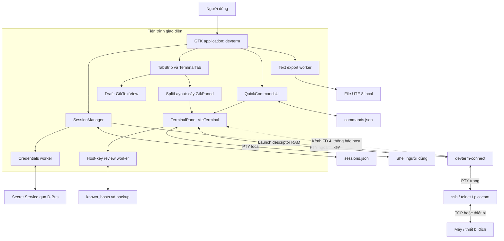
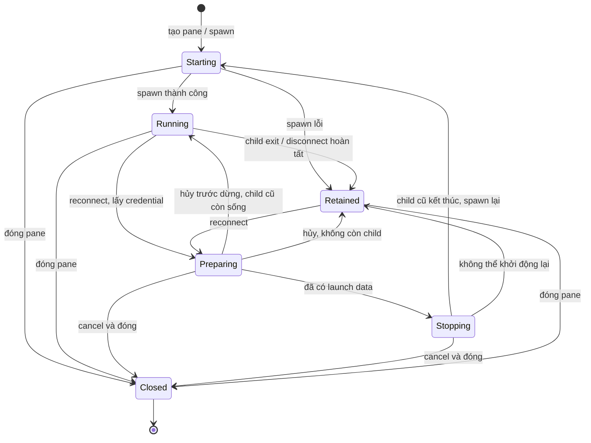
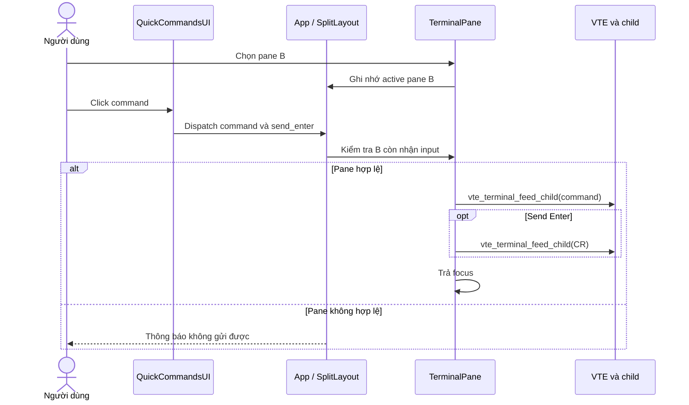
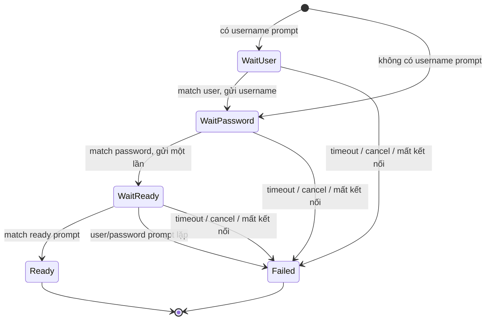

# SDD — Tài liệu thiết kế phần mềm DevTerm

| Thuộc tính | Giá trị |
| --- | --- |
| Sản phẩm / phiên bản | DevTerm 0.3.0 |
| Phiên bản tài liệu | 1.0 |
| Ngày lập | 13/11/2026 |
| Baseline source | `8612de6` — `[DT-11] feat: Add review host key when connect ssh session` |
| Đặc tả liên quan | [SRS.md](SRS.md) |
| Phạm vi | Thiết kế đang triển khai trong repository; không phải thiết kế cho các tính năng tương lai |

## Mục lục

1. [Mục tiêu và nguyên tắc thiết kế](#1-mục-tiêu-và-nguyên-tắc-thiết-kế)
2. [Kiến trúc tổng thể](#2-kiến-trúc-tổng-thể)
3. [Phân rã module](#3-phân-rã-module)
4. [Mô hình trạng thái và ownership](#4-mô-hình-trạng-thái-và-ownership)
5. [Thiết kế terminal, tab và split](#5-thiết-kế-terminal-tab-và-split)
6. [Thiết kế Quick Commands](#6-thiết-kế-quick-commands)
7. [Search, snapshot và Draft](#7-search-snapshot-và-draft)
8. [Sessions và bảo vệ credential](#8-sessions-và-bảo-vệ-credential)
9. [Reconnect tại pane hiện tại](#9-reconnect-tại-pane-hiện-tại)
10. [Thiết kế Review Host Key](#10-thiết-kế-review-host-key)
11. [Thiết kế dữ liệu](#11-thiết-kế-dữ-liệu)
12. [Build, đóng gói và triển khai](#12-build-đóng-gói-và-triển-khai)
13. [Kiểm thử và truy vết yêu cầu](#13-kiểm-thử-và-truy-vết-yêu-cầu)
14. [Quyết định thiết kế và giới hạn](#14-quyết-định-thiết-kế-và-giới-hạn)
15. [Quy tắc bảo trì tài liệu](#15-quy-tắc-bảo-trì-tài-liệu)

## 1. Mục tiêu và nguyên tắc thiết kế

DevTerm là ứng dụng native C11 trên Linux, sử dụng GTK4 và VTE dành cho GTK4. VTE cung cấp terminal emulator và PTY thật; `GtkTextView` chỉ dùng cho Draft, không giả lập terminal.

Các nguyên tắc chính:

1. **Giữ đúng phiên nhận input:** Quick Commands gửi vào child của VTE đã được chọn, không chạy qua shell phụ.
2. **Tách workspace khỏi tiến trình:** Tab/layout giữ danh tính và bố cục; reconnect thay client bên trong pane hiện tại.
3. **Không chờ công việc dài trên GTK thread:** Spawn bất đồng bộ; disk export, keyring và host-key review dùng worker; proxy PTY chạy trong helper riêng.
4. **Có ownership cho mọi callback:** Tác vụ giữ reference hoặc ID/weak reference phù hợp, có cancel và kiểm tra trạng thái trước cập nhật UI.
5. **Không tự mở rộng trust hoặc lưu secret plaintext:** Password qua keyring/RAM descriptor; host key chỉ thay khi có xác nhận rõ ràng.
6. **Giữ dữ liệu khi lỗi:** Ghi cấu hình/export theo cách thay thế atomic; file JSON lỗi không bị ghi đè tự động.

## 2. Kiến trúc tổng thể

### 2.1. Ranh giới tiến trình



Một pane local spawn shell trực tiếp bằng VTE. Một pane session spawn `devterm-connect` qua PTY ngoài; helper chạy client thật trên PTY trong, relay byte và kích thước terminal. Hai executable phải đặt cùng thư mục để frontend tìm helper và OpenSSH gọi askpass đúng binary.

### 2.2. Dependency và build graph

| Thành phần | Cách sử dụng |
| --- | --- |
| GTK4 ≥ 4.10 | Window, actions, notebook, paned, dialogs, clipboard, editor, event controllers |
| VTE GTK4 ≥ 0.70 | Emulator, shell spawn, input child, scrollback, search và snapshot text |
| JSON-GLib ≥ 1.6 | Model/config Quick Commands, Sessions và launch metadata |
| GLib/GIO | Main loop, cancellable, GTask, file, subprocess, socket và collections |
| PCRE2 | Biên dịch literal-search pattern cho VTE với Unicode/whole-word |
| libsecret ≥ 0.20 | Secret Service cho credential ghi nhớ |
| libutil | `forkpty()` trong helper |
| Meson/Ninja | Hai executable, GResource, header version và 14 nhóm test |

Phiên bản thư viện tìm thấy bằng `pkg-config` khi lập tài liệu: GTK 4.14.5, VTE 0.76.0, JSON-GLib 1.8.0 và libsecret 0.21.4. Đây là môi trường khảo sát, không thay thế version tối thiểu trong [meson.build](../meson.build).

`meson.build` sinh `devterm-version.h` với `DEVTERM_VERSION` và `DEVTERM_BUNDLED_RUNTIME`. `data/devterm.gresource.xml` đóng CSS vào frontend. `bundled_runtime=false` mặc định; bản Ubuntu 22.04 bật option này để khởi tạo schema GTK riêng.

## 3. Phân rã module

Các cặp `.c/.h` dùng header công khai cho phần giao tiếp; state nội bộ được giữ trong implementation khi có thể.

| Module | Trách nhiệm chính | Hợp đồng / liên kết |
| --- | --- | --- |
| [main.c](../src/main.c) | GtkApplication, cửa sổ, actions, tab ownership, chọn đích, dialog đóng, điều phối export/session | Giữ `App`, `TerminalTab`; chuyển action đến tab/pane hiện tại |
| [pane.c](../src/pane.c) | VTE, spawn/exit, search, scrollbar, selection, snapshot, disconnect/reconnect, UI review key | `pane_new*`, `pane_send`, `pane_reconnect_*`, `pane_snapshot_text`, `pane_close` |
| [split-layout.c](../src/split-layout.c) | Cây nhị phân split, active pane, hình học, collapse, thông báo | `split_layout_split`, `split_layout_close_active`, `split_layout_active` |
| [tab-strip.c](../src/tab-strip.c) | Nhãn/menu tab, rename, reorder, drag cancel, xử lý focus | Callback theo tab ID; không sở hữu PTY/layout của tab |
| [commands.c](../src/commands.c) | Model QuickCommand, XDG path, JSON load/save | Giữ thứ tự, validation khi load, atomic save |
| [quick-commands-ui.c](../src/quick-commands-ui.c) | Toolbar/Manage, CRUD, confirm delete, reorder và persistence UI | Dispatch command qua callback; lưu thành công mới chấp nhận thay đổi |
| [draft.c](../src/draft.c) | Editor theo tab, chia chiều cao, Copy/Clear/Undo và focus | Bao terminal layout trong GtkPaned; không giao tiếp child |
| [confirm-dialog.c](../src/confirm-dialog.c) | Hộp thoại xác nhận dùng chung, mặc định Cancel | Callback kết quả và destroy notifier cho context |
| [text-export.c](../src/text-export.c) | Ghi snapshot bất đồng bộ ra file local | `text_export_async/finish`; giữ `GBytes` đến khi hoàn tất |
| [sessions.c](../src/sessions.c) | Model/validation/schema profile, endpoint binding, launch descriptor | Dùng chung frontend và helper; không chứa UI keyring |
| [sessions-ui.c](../src/sessions-ui.c) | Profile editor/manager, chuẩn bị credential, Connect/Current Pane | Callback Connect tạo tab; `session_manager_connect_to` phục vụ đúng pane chờ reconnect |
| [credentials.c](../src/credentials.c) | Lookup/store/clear password qua libsecret | Tác vụ xếp hàng trên worker để giữ thứ tự store/edit/delete |
| [connect-helper.c](../src/connect-helper.c) | Launch client, PTY relay, resize, signal cleanup, SSH askpass, trusted diagnostics | Tiến trình riêng; không block GTK frontend |
| [login.c](../src/login.c) | State machine auto-login Telnet/Serial | Nhận chunk output, trả action; không trực tiếp tạo widget hoặc ghi config |
| [ssh-host-key.c](../src/ssh-host-key.c) | Chuẩn bị review, phân tích key/file, backup và replace có conflict check | API async cho UI; API blocking chỉ dùng worker/test |
| [ui-style.c](../src/ui-style.c), [style.css](../data/style.css) | CSS, sáng/tối, đồng bộ style trong ứng dụng | Provider sống theo GtkApplication; cửa sổ dùng reference phù hợp |
| [runtime.c](../src/runtime.c) | Khởi tạo schema khi dùng runtime đóng kèm | Chỉ compile khi `bundled_runtime=true`; phục hồi environment trước khi spawn child |

## 4. Mô hình trạng thái và ownership

### 4.1. Workspace

```text
GtkApplication
└── App cho mỗi cửa sổ
    ├── GtkNotebook + TabStrip
    ├── GPtrArray<TerminalTab*> theo thứ tự hiển thị
    │   └── TerminalTab
    │       ├── id, title, status message, close dialog
    │       ├── SplitLayout
    │       │   ├── root LayoutNode
    │       │   └── active TerminalPane (con trỏ không sở hữu riêng)
    │       └── Draft
    │           ├── GtkPaned: terminal layout / editor
    │           └── GtkTextBuffer + trạng thái editor
    ├── QuickCommandsUI + model commands
    ├── SessionManager + model profiles
    └── export cancellable, focus idle, trạng thái shutdown
```

`TerminalTab.id` ổn định trong cửa sổ, độc lập index `GtkNotebook` và title. `QuickCommand.id` và `SessionProfile.id` được lưu xuống JSON. Profile mới dùng UUID; parser Quick Commands chấp nhận ID chuỗi không rỗng/chỉ whitespace và duy nhất, không bắt buộc mọi ID cũ phải theo định dạng UUID.

`LayoutNode` là leaf chứa pane hoặc branch chứa hai node con và `GtkPaned`. Mỗi node biết parent; branch có callback cân divider khi allocation sẵn sàng. Widget hierarchy và model tree phải được cập nhật cùng nhau.

### 4.2. Vòng đời pane

`TerminalPane` dùng refcount riêng bên cạnh reference của widget GObject. Owner giữ một reference; callback spawn/async có thể giữ reference bổ sung. Cờ `closed` ngăn callback muộn cập nhật widget đã hủy hoặc gửi input.

Sơ đồ sau là trạng thái khái niệm; implementation dùng flags như `starting`, `running`, `disconnecting` và enum reconnect, không có một enum duy nhất cho toàn sơ đồ:



Không xóa pane tự động khi child exit. `pane_is_running()` và đường gửi input loại trừ pane đã đóng, đang disconnect/reconnect hoặc không có child chạy. Output cũ vẫn phục vụ Search/Copy/Export.

Khi đóng pane: đánh dấu closed, hủy tác vụ/cancellable và timer/search debounce/host review, kết thúc child bằng signal thích hợp, ngắt signal widget và giải phóng reference owner. Callback còn sống tự hoàn tất và bỏ reference; phải kiểm tra closed trước sử dụng UI.

### 4.3. Focus và callback target

- `SplitLayout` nhớ active pane ngay cả khi toolbar, menu hoặc dialog có keyboard focus.
- Khi đổi tab, tạm suspend focus tracking của layout/Draft; GTK có thể gán focus mặc định tạm thời cho widget đầu tiên. Idle callback sau đổi trang khôi phục pane/Draft được nhớ.
- `tab_strip_busy()` tránh việc khôi phục focus terminal chen vào thao tác rename/menu/drag tab.
- Action tab dùng ID ổn định và tìm lại tab lúc xử lý; không dùng index đã chụp trước reorder.
- Reconnect/host-key callback giữ đúng pane nguồn; không tra lại global active pane khi tác vụ hoàn tất.
- Export giữ snapshot độc lập, không cần pane tiếp tục tồn tại.
- Các dialog/request liên quan window dùng weak reference hoặc context được quản lý; shutdown hủy request trước khi phá owner.

### 4.4. Thứ tự shutdown cửa sổ

`App.shutting_down` ngăn callback phát sinh công việc mới. Quá trình destroy giải phóng TabStrip/QuickCommandsUI, đóng dialog, hủy SessionManager và export, xóa focus idle, disconnect notebook callbacks rồi dispose các tab. Provider style thuộc vòng đời ứng dụng, không bị giải phóng chỉ vì một cửa sổ đóng.

Đóng tab có dialog riêng nếu còn live/starting child hoặc Draft. Đóng cửa sổ chỉ bật xác nhận mất Draft khi có nháp; nếu không có nháp thì hiện không có xác nhận bổ sung chỉ cho live child. Một dialog đóng tab đang mở được ưu tiên để tránh hai quyết định đóng cạnh tranh.

## 5. Thiết kế terminal, tab và split

### 5.1. Terminal local

`pane_create()` tạo header, search bar, VteTerminal và scrollbar. VTE được cấu hình:

```c
vte_terminal_set_scrollback_lines(terminal, 10000);
vte_terminal_set_scroll_on_output(terminal, FALSE);
vte_terminal_set_scroll_on_keystroke(terminal, TRUE);
```

Scrollbar dùng adjustment của VTE, đặt bên phải và luôn hiện. Gesture/click chọn pane nhưng không biến kéo scrollbar thành terminal input. Không có lịch sử thì adjustment không cuộn được, widget vẫn giữ chỗ. Alternate screen không mở ra lịch sử nội bộ của ứng dụng đang chạy.

Shell lấy từ `$SHELL` nếu là đường dẫn tuyệt đối tới regular executable; fallback `/bin/sh`. `vte_terminal_spawn_async()` tạo PTY/child, callback cập nhật PID/state hoặc thông báo lỗi. Local cwd ưu tiên thư mục của active local shell đọc qua `/proc`, fallback home; remote cwd không được coi là local path.

### 5.2. Split và hình học

Khi split leaf L:

1. Nhớ parent/container và vị trí divider ngoài cần giữ.
2. Tạo pane mới R cùng hướng cwd local phù hợp.
3. Thay L bằng branch B có hai child L/R; reparent widget với reference tạm hợp lệ.
4. Gắn tick callback cho B, chờ allocation thực tế rồi đặt divider khoảng 50% một lần.
5. Giữ vị trí/tỷ lệ các ancestor; chọn và focus pane mới.

Không set divider từ chiều rộng/cao của một widget chưa được allocate và không cân lại toàn bộ cây. Đây là điều kiện tránh lỗi split liên tiếp co pane về mép. Khi đóng leaf, bỏ branch cha và promote sibling; khi sibling là branch thì giữ nguyên subtree của nó.

```text
Một pane A       Split Right A       Split Right B

    A                A | B               A | B | C
   100%             50% 50%             50% 25% 25%
```

Khi resize, GtkPaned kết hợp chính sách giữ tỷ lệ/kích thước và giới hạn allocation của children. Không bảo đảm tỷ lệ chính xác khi cửa sổ nhỏ hơn kích thước tối thiểu các widget.

### 5.3. Tab strip

`GtkNotebook` quản lý pages, bật reorderable và tắt detachable. `TabStrip` quản lý nhãn icon/title/×, menu và validation rename. Tên trim và giới hạn 128 Unicode characters; nhãn rút gọn khi dài, tooltip giữ tên đầy đủ, accessible label của nút đóng được cập nhật. Rename không đổi SessionProfile, cập nhật Draft header và thông báo đóng.

Native notebook có thể commit reorder ngay cả khi gesture bị hủy. Vì vậy TabStrip chụp thứ tự ban đầu ở press, theo dõi ngưỡng kéo và vùng thanh tab bằng event controller. Esc, grab broken hoặc thả ngoài vùng hợp lệ phục hồi snapshot; việc phục hồi sau release có thể được schedule idle để chạy sau handler native. Nút × tạm khóa reorder lúc press để không bắt đầu drag.

Signal `page-reordered` cập nhật mảng `App.tabs` theo thứ tự notebook bằng cách gán lại pointer tại chỗ; không remove/free tab đang sống. Khi đóng tab trong lúc drag, hủy/khôi phục drag trước rồi tính lại index trang cần xóa. Ctrl+PageUp/PageDown luôn dựa trên thứ tự hiển thị hiện tại.

## 6. Thiết kế Quick Commands

### 6.1. Model, UI và gửi input

`QuickCommand` gồm `id`, `name`, `command`, `send_enter`. `commands.c` đọc/ghi model; `QuickCommandsUI` quản lý toolbar dạng FlowBox, vùng cuộn, editor, menu và Manage. Main nhận callback dispatch để giải quyết active pane.



Không tokenize command, không nội suy qua shell phụ, không gọi `system()`/`popen()`, không tự Ctrl+C/xóa dòng. Shell local, SSH remote hay `vim` quyết định ý nghĩa byte nhận được. Input có nhiều dòng có thể được chương trình diễn giải ngay theo trạng thái của nó.

### 6.2. CRUD, vị trí danh sách và kéo thả

Editor thao tác theo ID, giữ nội dung nếu validation/save thất bại. Delete từ menu/Manage đi qua confirm mặc định Cancel. Manage dùng hàng ổn định theo ID để giữ scroll và focus; khi xóa chọn hàng kế tiếp, hoặc hàng trước nếu xóa cuối. Chỉ cuộn vừa đủ để hàng được chọn hiển thị.

Toolbar DnD dùng payload nội bộ `G_TYPE_OBJECT`, không cung cấp `text/plain` chứa command. Nhờ đó kéo nút sang VTE không trở thành paste/thực thi lệnh. Khi bắt đầu drag, lưu snapshot thứ tự; preview và insertion marker cập nhật trong vùng đích; auto-scroll ở mép vùng Quick Commands. Chỉ persist khi drop hợp lệ; Esc/drop ngoài khôi phục thứ tự, ngăn click sau drag gửi command. Đường xử lý Escape giữ focus/grab phù hợp để không làm ký tự hủy lọt vào child.

### 6.3. Persistence và rollback

Model được giữ theo `GPtrArray`, thứ tự chính là thứ tự serialize. Save Quick Commands tạo sibling temp bằng `g_mkstemp()`, ghi đủ bytes với xử lý `EINTR`, `fsync()`, close rồi `rename()`. Lỗi trước rename xóa temp và giữ file cũ; UI rollback thay đổi chưa lưu.

Load kiểm tra root/version/array, trường bắt buộc, UTF-8 không chỉ whitespace và ID duy nhất. File chưa có trả danh sách rỗng. File lỗi trả GError; UI thông báo, khóa chỉnh sửa để không ghi đè cấu hình lỗi bằng danh sách rỗng. Save API giả định caller cung cấp model đã được validate; không nên dùng nó như một validator độc lập cho mọi dữ liệu tùy ý.

## 7. Search, snapshot và Draft

### 7.1. Tìm kiếm theo pane

`TerminalPane` sở hữu query, Match case, Whole word, regex dirty flag, feedback và timer 150 ms. Query được escape thành literal trước khi biên dịch `VteRegex`; không mở chế độ regex cho người dùng. Cờ dùng PCRE2 Unicode properties; mặc định case-insensitive.

Whole-word bao quanh literal bằng boundary tường minh:

```text
(?<![\p{L}\p{M}\p{N}_])(?:LITERAL)(?![\p{L}\p{M}\p{N}_])
```

`\p{M}` giữ dấu kết hợp Unicode như thành phần từ. Query rỗng xóa search highlight và khóa điều hướng; Not found cập nhật feedback. Khi terminal chưa mapped do đổi tab, thao tác tìm được hoãn đến khi có allocation/mapping hợp lệ. Đóng pane hủy timer trước giải phóng state.

Enter/Shift+Enter và Esc được xử lý trong search UI, không feed child. Tìm kiếm dựa vào API VTE, vì vậy giữ giới hạn điều hướng theo dòng logic của VTE 0.76 và phạm vi buffer hiện tại.

### 7.2. Snapshot và export

`pane_snapshot_text()` lấy text từ VTE của active buffer, gồm scrollback đang giữ; soft-wrap được nối thành dòng logic. Snapshot UTF-8/LF không chứa ANSI/định dạng màu. Không lấy lịch sử shell ẩn phía sau alternate screen và không phải recording liên tục.

Copy All đưa snapshot lên clipboard. Export tạo immutable `GBytes` **trước** khi mở `GtkFileDialog`, kèm tên gợi ý và text filter. Worker nhận `GFile` và `GBytes`, không đọc lại VTE:

```text
GTK thread:  resolve pane → snapshot GBytes → Save dialog → text_export_async
Worker:      local path → temp cùng thư mục → write chunks → fsync → close
             → kiểm tra cancel trước commit → rename sang file đích
GTK thread:  finish → báo thành công/lỗi → giải phóng request
```

`text-export.c` từ chối non-local destination. File tạm/new file quyền 0600; lỗi không fallback sang truncate file cũ. Worker tắt cơ chế tự chuyển kết quả thành cancelled sau commit để cancel đến muộn không báo thất bại dù file đã được thay. `GBytes`/`GFile` sống đến completion, tách khỏi pane lifetime.

Trích xuất VTE vẫn chạy trên GTK thread; buffer lớn có thể gây chờ ngắn và cấp phát snapshot trong RAM. Ghi đĩa chạy worker. Atomic rename không phải cam kết tuyệt đối bền vững trước mọi kiểu mất điện; implementation không cung cấp transaction xuyên filesystem.

### 7.3. Draft theo tab

`Draft` nhận widget SplitLayout và bọc trong GtkPaned dọc: terminal ở trên, editor ở dưới. Lần đầu mở đặt khoảng 70/30; panel dùng GtkTextView/TextBuffer monospace, wrap và scroller. Hidden không destroy editor nên giữ caret, selection, scroll, undo và divider. Mỗi tab có instance riêng.

Copy lấy selection hoặc toàn bộ text, không thay đổi buffer. Clear dùng confirm, gộp thay đổi thành một user action để Undo được. Các editor shortcut được xử lý trong editor; không có đường từ Draft tới `vte_terminal_feed_child()`. `draft_has_text()` xét bất kỳ nội dung nào, kể cả whitespace; không dùng cờ modified sau Copy để quyết định hỏi đóng. Rename cập nhật tiêu đề Draft theo tab.

## 8. Sessions và bảo vệ credential

### 8.1. Profile và SessionManager

SessionManager sở hữu danh sách `SessionProfile`, config path, trạng thái load hợp lệ và các dialog/request chờ. CRUD lưu metadata; lỗi save khôi phục model. Duplicate tạo UUID mới, tắt remember và không sao chép credential. Delete profile hiện được xử lý trực tiếp trong Sessions và yêu cầu clear credential; **không dùng quy tắc confirm Delete của Quick Commands**.

Profile dùng chung mọi field dù UI chỉ hiển thị field của giao thức đang chọn. Pane copy profile khi connect; sửa/xóa profile trong manager không đổi session đang sống hoặc endpoint reconnect của pane đó.

`session_manager_connect_to()` chuẩn bị credential với cancellable và callback/destroy notifier, không tự tạo tab. Main dùng callback Connect thông thường để mở tab; reconnect dùng callback gắn pane cụ thể. Request/parent window được quản lý để callback sau hủy không mở tab hay tác động window đã đóng.

### 8.2. Keyring

`credentials.c` dùng schema `com.example.DevTerm.Session`, hai attribute `profile` và `endpoint`. Endpoint là SHA-256 của chuỗi:

```text
type|host|port|username|device
```

SHA-256 ở đây là khóa phân loại endpoint, không phải hash dùng để lưu password. Password thực được lưu trong Secret Service. Rename không đổi binding; endpoint đổi không lookup credential của đích cũ. Lookup/store/clear dùng GTask trên thread pool một worker để tránh store cũ hoàn tất sau delete mới làm sống lại credential. Các bản sao secret được xóa bằng `session_secret_free()` khi giải phóng.

Không có keyring thì người dùng vẫn nhập password từng lần. Không tạo file fallback và không triển khai thuật toán mã hóa riêng. Secret Service phụ thuộc session desktop; app khác cùng tài khoản/phiên mở khóa có thể được dịch vụ cho truy cập theo chính sách hệ thống.

### 8.3. Launch descriptor và IPC

Frontend không nhúng password vào argv hoặc environment. `session_launch_fd()` tạo Linux anonymous `memfd`, ghi rồi seal, truyền cho helper tại **FD 3**. Binary framing:

```text
uint32 big-endian: số byte JSON profile
uint32 big-endian: số byte password
byte[]: JSON UTF-8 của profile, không có trường password
byte[]: password UTF-8, không kèm NUL terminator
```

Reader giới hạn JSON 1–65.536 byte, password tối đa 1.023 byte; password bắt buộc khi phương thức xác thực cần, không chứa ký tự điều khiển. Lỗi dữ liệu bị từ chối trước launch client. Password không được ghi vào temporary file trên đĩa. Frontend/helper tắt core dump/dumpability cho bộ nhớ của chính chúng theo luồng khởi tạo.

SSH askpass là mode của helper, dùng private Unix socket trong thư mục runtime quyền 0700. Socket kiểm peer credentials và quan hệ với SSH child dự kiến, trả password một lần rồi wipe. SSH nhận đường dẫn helper/socket điều khiển cần thiết, không nhận giá trị password trong environment. Chỉ xử lý prompt password và xác nhận host key được nhận diện; không trả password tùy ý cho prompt không xác định.

### 8.4. Client thật và relay PTY

Helper nhận launch profile, chọn chương trình theo giao thức bằng argv riêng, không nội suy shell command. `forkpty()` tạo client PTY; vòng poll relay output/input và resize, theo dõi timeout/cancel/exit.

| Giao thức | Cách chạy và ràng buộc |
| --- | --- |
| SSH | OpenSSH với PTY, port/user/identity, `StrictHostKeyChecking=ask`, một password prompt, một connection attempt, không reuse ControlPath, không forward agent; password mode không trả lời keyboard-interactive |
| Telnet | Client `telnet -8 -E -c`: byte 8-bit, tắt escape và bỏ `.telnetrc`; dữ liệu mạng không mã hóa |
| Serial | picocom với device và baud/data/parity/stop/flow; giữ lock của client, tắt local escape; initial Enter sau mở cổng khi được chọn |

SIGWINCH chuyển dimensions PTY ngoài vào PTY trong. SIGHUP/TERM/cancel kết thúc process group client, chờ có giới hạn rồi cưỡng bức nếu cần. Parent-death handling giúp không để helper/client tiếp tục khi frontend mất. Kết thúc phiên vẫn không thể đảm bảo mọi tiến trình đã daemonize/tách khỏi process group sẽ bị dọn như shell job thông thường.

### 8.5. Auto-login Telnet/Serial

`LoginMachine` nhận chunks, loại ANSI CSI/OSC qua ranh giới chunk, xử lý backspace và giữ cửa sổ text tối đa 8.192 byte để so prompt. Regex phải có match kết thúc tại cuối dữ liệu hiện nhận; username prompt có thể trống để bắt đầu thẳng ở trạng thái đợi password.



`login.c` trả `LOGIN_WAIT`, `LOGIN_SEND_USER`, `LOGIN_SEND_PASSWORD`, `LOGIN_READY` hoặc `LOGIN_FAILED`; timeout, Ctrl+C/Esc và client lifecycle do helper quản lý. Trong giai đoạn tự động, helper không relay transcript xác thực vào VTE, kể cả thiết bị echo password; input tương tác khác bị bỏ qua. Sau ready, relay bình thường. Diagnostic an toàn trước khi gửi secret có thể được giữ để báo lỗi mở cổng; không in lại buffer có khả năng chứa password.

## 9. Reconnect tại pane hiện tại

Enum implementation gồm `RECONNECT_NONE`, `RECONNECT_PASSWORD`, `RECONNECT_STOPPING`, `RECONNECT_STARTING`. Thứ tự xử lý:

1. Pane ghi nhận reconnect request, khóa input và chuẩn bị cancellable gắn với chính pane.
2. SessionManager lấy password/keyring hoặc xác định key/agent. Hủy ở giai đoạn này kết thúc request, không dừng client cũ.
3. Tạo launch descriptor hợp lệ trước khi chấm dứt phiên cũ; failure chưa phá kết nối cũ.
4. Gửi dừng, chờ `child-exited`; stop timeout 5 giây không cho spawn chồng nếu chưa xác nhận child cũ kết thúc.
5. Schedule respawn sau khi signal và default handler VTE hoàn tất; dùng lại cùng widget VteTerminal. Child/PTY của lần spawn mới được tạo lại, không giữ kết nối PTY cũ như một phiên còn sống.
6. Chuẩn bị terminal về normal screen/cursor phù hợp để output mới được nối tiếp; không xóa toàn bộ history.
7. Spawn helper mới, cập nhật state/thông báo/focus. Lỗi giữ pane để xem và thử lại; không auto-retry.

VTE 0.76 bỏ qua một số reset khi input bị disable; implementation tạm xử lý trạng thái input quanh reset cần thiết. Về normal screen dùng escape sequence của terminal và đặt cursor để tránh ghi đè phần output cũ. Bảo toàn history vẫn chịu giới hạn scrollback và escape sequence clear-history mà chương trình mới có thể gửi.

Các timer/launch fd/request thuộc vòng đời pane. Đóng pane trong khi đợi password/stop/spawn phải hủy hoặc đóng tài nguyên tương ứng; callback giữ reference, kiểm tra state/cancellable trước tác động. Đổi active pane không đổi đích request đã khởi tạo.

## 10. Thiết kế Review Host Key

### 10.1. Nguồn thông báo đáng tin cậy hơn terminal text

Frontend và helper có socketpair `AF_UNIX/SOCK_SEQPACKET` riêng, helper nhận ở **FD 4**. Helper không cho SSH client/remote kế thừa kênh này. Message bắt đầu bằng `DEVTERM-HOST-KEY-CHANGED-1\n`, giới hạn 32.768 byte; frontend theo dõi FD bằng GLib source và hiện action review.

Không thể chỉ truyền diagnostic FD mở sẵn vào `ssh`: OpenSSH đóng các FD bổ sung ở giai đoạn khởi động. Helper vì vậy tạo thư mục riêng 0700 và FIFO diagnostic 0600, chạy `ssh -v -E <fifo>`, đọc log của client tách khỏi output PTY do remote kiểm soát. Debug noise được lọc; warning cần thiết vẫn tới pane.

Chỉ gửi notice khi OpenSSH exit 255, diagnostic chứa cả cảnh báo key thay đổi và verification failed, phiên chưa xác thực/chưa giao password, và không đang stop. Remote in chuỗi cảnh báo giả trong output sau đăng nhập không đủ kích hoạt Review Host Key. Close/cancel dọn watcher, socket và FIFO/thư mục riêng.

### 10.2. Chuẩn bị review

`ssh_host_key_prepare_async()` chạy worker, giữ profile/diagnostic snapshot và cancellable:

1. Dùng `ssh -G` đọc cấu hình hiệu lực. Xác định hostname/port/UserKnownHostsFile; từ chối ProxyJump, ProxyCommand và HostKeyAlias trong luồng tự động.
2. Phân tích offending file/line và fingerprint mới từ diagnostic của OpenSSH; chuẩn hóa endpoint: port 22 dùng hostname, port khác dùng `[host]:port`, có xét IPv6.
3. Chỉ chấp nhận file regular không symlink, thuộc effective UID, có thể ghi và tối đa 8 MiB; không chứa NUL. Đọc bytes gốc và GFile etag.
4. Dùng snapshot riêng và `ssh-keygen -F` xác định entry khớp endpoint, kể cả hashed host. Giữ nguyên entry khác và alias khác trên cùng dòng nếu xử lý an toàn.
5. Lấy key ứng viên qua `ssh-keyscan`; kiểm thuật toán trong key blob, tính SHA-256 và yêu cầu khớp fingerprint OpenSSH đã báo. Keyscan không thực hiện đăng nhập.
6. Tạo `SshHostKeyReview`: endpoint, file, fingerprints cũ/mới, algorithm, tên backup, bytes original/replacement và etag.

Entry wildcard/negated phức tạp, `@cert-authority`/`@revoked`, file hệ thống hay trường hợp không xác định chắc được giữ nguyên và báo xử lý thủ công. Key đã có trong trạng thái hiện tại hoặc candidate đổi không được thay mù.

### 10.3. Consent, backup và commit

Dialog thuộc pane, Cancel mặc định. Copy Fingerprint chỉ copy fingerprint mới. Checkbox xác nhận đã đối chiếu qua nguồn độc lập mới mở Replace Key & Reconnect. Checkbox là consent, không phải thuật toán chứng minh người dùng đã xác minh đúng thiết bị.

`ssh_host_key_replace_async()` thực hiện:

```text
cancel/check regular file + owner
→ so bytes hiện tại và etag với snapshot
→ tạo exclusive backup known_hosts.devterm-UUID.bak (0600)
→ ghi nguyên bytes cũ, fsync và close
→ kiểm tra file/điều kiện lần nữa
→ GFile replace với expected etag, private destination
→ báo thành công
→ callback reconnect đúng pane nguồn
```

Không xóa toàn bộ endpoint bằng lệnh `ssh-keygen -R` rồi tự chấp nhận key tiếp theo: replacement giữ khóa ứng viên cụ thể đã được xác nhận. Concurrent edit dẫn tới failure, không overwrite phiên bản mới. Đây là kiểm soát bằng snapshot/etag của backend file local, không phải khóa độc quyền mọi tiến trình có thể sửa `known_hosts`.

Backup có thể còn khi bước commit thất bại sau backup; backup không tự xóa. Khi commit đã xong, hủy password hoặc lỗi reconnect không rollback trust. Reconnect vẫn dùng OpenSSH strict checking bình thường; server đổi sang key khác sẽ bị từ chối trước password.

### 10.4. Lifetime tác vụ review

Review struct có refcount; prepare/replace tasks giữ reference và dữ liệu độc lập. Pane giữ cancellable và kiểm tra identity của request để bỏ kết quả stale. Đóng pane ngắt notice source, đóng dialog, cancel worker/subprocess và không gọi reconnect. Subprocess có timeout và cleanup để cancel scan không để client quét chạy tiếp vô hạn.

## 11. Thiết kế dữ liệu

### 11.1. XDG và bảo toàn cấu hình

Hai model dùng `$XDG_CONFIG_HOME/devterm/`; khi biến thiếu/rỗng fallback `~/.config/devterm/`. Tạo directory với mode 0700. Quick Commands dùng temp 0600/rename; Sessions dùng `g_file_set_contents_full()` với `CONSISTENT | DURABLE`, mode 0600. Mode này không phải thao tác siết lại quyền mọi directory/file cũ đã có từ trước.

File version khác 1, sai loại dữ liệu, thiếu field hoặc ID trùng bị từ chối. Không có migration tự động. Không merge khi nhiều tiến trình/công cụ cùng chỉnh JSON; atomic replace chỉ ngăn partial file, có thể last-writer-wins. Dữ liệu dùng chung `known_hosts` có cơ chế conflict check riêng đã mô tả.

### 11.2. `commands.json`

```json
{
  "version": 1,
  "commands": [
    {
      "id": "2cf44db0-9124-445b-921b-c967520a8fe6",
      "name": "Check internet",
      "command": "ping 8.8.8.8",
      "send_enter": true
    },
    {
      "id": "3382daed-d0b2-4e5f-82b7-e953239ca402",
      "name": "Nháp lệnh",
      "command": "printf '%s\\n' 'Xin chào' | cat",
      "send_enter": false
    }
  ]
}
```

| Field | Kiểu / ràng buộc |
| --- | --- |
| `version` | Integer bằng 1 |
| `commands` | Array, thứ tự phần tử là thứ tự toolbar/Manage |
| `id` | String không rỗng/chỉ whitespace, duy nhất trong file, giữ khi edit/reorder |
| `name` | String UTF-8 không rỗng/chỉ whitespace |
| `command` | String UTF-8 không rỗng/chỉ whitespace; nội dung được gửi nguyên văn |
| `send_enter` | Boolean bắt buộc |

### 11.3. `sessions.json`

Ví dụ đầy đủ một profile password SSH; các trường giao thức khác vẫn có mặt theo schema hiện tại:

```json
{
  "version": 1,
  "sessions": [
    {
      "id": "572bc287-c861-4323-b0bd-a6c9f1a93af8",
      "name": "Router Lab",
      "type": 0,
      "host": "192.0.2.1",
      "port": 22,
      "username": "admin",
      "identity": "",
      "device": "",
      "baud": 115200,
      "data_bits": 8,
      "stop_bits": 1,
      "parity": "none",
      "flow": "none",
      "timeout": 30,
      "password_auth": true,
      "remember": false,
      "auto_login": false,
      "send_initial_enter": false,
      "login_prompt": "(?i)(login|username)\\s*:\\s*$",
      "password_prompt": "(?i)password\\s*:\\s*$",
      "ready_prompt": "router#\\s*$"
    }
  ]
}
```

| Field / nhóm | Kiểu / validation |
| --- | --- |
| `version`, `sessions` | Integer 1 và array; UUID profile không trùng |
| `id` | UUID hợp lệ |
| `name` | UTF-8 tối đa 128 byte, không control ASCII, không trống sau trim |
| `type` | Integer: 0 SSH, 1 Telnet, 2 Serial |
| `host`, `port` | Host tối đa 253 byte; network profile cần IP/hostname hợp lệ, không bắt đầu `-`; port 1–65535 |
| `username` | UTF-8 tối đa 128 byte, không control ASCII; SSH yêu cầu tên không rỗng theo tập ký tự cho phép trong validator |
| `identity`, `device` | Tối đa 4096 byte; identity nếu có phải tuyệt đối; Serial device tuyệt đối và dưới `/dev/` |
| `baud`, `data_bits`, `stop_bits` | Serial: 50–4.000.000; 5–8; 1–2 |
| `parity`, `flow` | Serial: `none/even/odd`; `none/hard/soft` |
| `timeout` | Integer 5–120 giây, mặc định 30 |
| `password_auth` | Boolean; SSH chọn password hoặc key/agent |
| `remember` | Boolean consent ghi nhớ; bản thân không chứa password |
| `auto_login` | Boolean bật prompt engine cho Telnet/Serial |
| `send_initial_enter` | Boolean gửi Enter khởi đầu theo giao thức |
| `login_prompt`, `password_prompt`, `ready_prompt` | String, khi auto-login Telnet/Serial phải là regex hợp lệ tối đa 512 byte, không match chuỗi rỗng; login prompt được phép rỗng |

Parser yêu cầu các field trong ví dụ và đúng JSON type; **bất kỳ profile nào có member `password` đều bị từ chối**. Các giới hạn byte của profile khác giới hạn 128 Unicode characters của rename tab. Khi chỉ đổi tên profile, credential binding không đổi. Private key chỉ lưu đường dẫn; nội dung private key không được DevTerm sao chép vào config.

### 11.4. Dữ liệu chỉ nằm trong RAM

Tên/thứ tự tab, cây split, active pane, Draft và undo stack, query/options Search, theme và output VTE không có schema persistence. Không ghi những dữ liệu này vào `commands.json` hoặc `sessions.json`. Export và backup host key là hai loại file được tạo qua hành động riêng của người dùng.

## 12. Build, đóng gói và triển khai

### 12.1. Build source

Trên môi trường đã cài dependency phù hợp:

```sh
meson setup build
meson compile -C build
./build/devterm
./build/devterm --version
```

Nếu `build` đã được setup thì dùng `meson compile -C build`; khi đổi dependency/cache có thể cần reconfigure theo [README](../README.md). Không chuyển executable chính sang máy khác mà bỏ helper. Meson install cài cả hai cùng bindir; pipeline `.deb` sắp xếp payload riêng và launcher.

### 12.2. Pipeline `.deb`

| Thành phần | Vai trò |
| --- | --- |
| [build-debs.py](../packaging/build-debs.py) | Host orchestrator chọn Ubuntu/CPU, Docker builder, source/output mounts, jobs/revision |
| [Dockerfile](../packaging/Dockerfile), [build.py](../packaging/build.py) | Toolchain/dependency trong container, build source, test bằng user thường, stage ELF/dependencies và package |
| [runtime.py](../packaging/runtime.py), [runtime-sources.json](../packaging/runtime-sources.json) | Nguồn runtime riêng, hash lock/cache và build cho Jammy |
| [build-mint-deb.py](../packaging/build-mint-deb.py) | Tái đóng gói payload Noble amd64 đã có report thành Mint 22.1, đổi metadata/OS guard |
| [verify-debs.py](../packaging/verify-debs.py), [verify-installed.py](../packaging/verify-installed.py) | Cài và kiểm artifact trong môi trường sạch dùng một lần |
| [gui-probe.py](../packaging/gui-probe.py) | Probe GUI/VTE/PTY và runtime environment sau cài |

Host cần Docker hoạt động, Python 3 và dung lượng; lệnh orchestrator tự gọi Docker, không cần người dùng tự chạy container trước. Cross-build/test cần QEMU/binfmt hoặc host cùng kiến trúc; script không tự đổi binfmt của máy.

```sh
# Một tổ hợp; script tự build/run container Docker.
python3 packaging/build-debs.py --ubuntu 24.04 --arch amd64

# Ma trận Ubuntu 22.04/24.04 × amd64/arm64.
python3 packaging/build-debs.py

# Chỉ định artifact cần kiểm tra trong container sạch.
python3 packaging/verify-debs.py dist/devterm_0.3.0-1~ubuntu24.04_amd64.deb
```

Các lệnh là đường thực thi theo scripts, không phải bằng chứng đã chạy trong lần viết tài liệu. Version/revision artifact phụ thuộc `meson.build` và tham số build; thay tên ví dụ cho đúng file thực tế. Cần kiểm report `.tests.txt`, `.build.json` và `SHA256SUMS` của chính artifact định phát hành.

Ubuntu 24.04 dùng thư viện hệ thống; Ubuntu 22.04 đóng GLib/Wayland/GTK/VTE riêng dưới `/usr/lib/devterm/runtime`, build với ABI Jammy từ source lock. ELF RUNPATH dẫn đến runtime riêng; launcher không export `LD_LIBRARY_PATH` hay PATH riêng vào terminal shell. `runtime.c` tạm cấu hình schema GTK trước UI init rồi phục hồi environment để child dùng môi trường hệ thống.

Payload frontend/helper đặt trong `/usr/lib/devterm/`; `/usr/bin/devterm` gọi frontend. Desktop entry/icon cài vào vị trí hệ thống. Không đóng gói user JSON, password, keyring hay metadata Git. Upgrade/remove không xóa cấu hình XDG của người dùng. Runtime đóng kèm cần maintainer cập nhật lock/build/test khi có sửa lỗi, không được APT tự nâng từng thư viện riêng.

**Tồn đọng packaging tại baseline:** `build-mint-deb.py` dùng artifact mặc định 0.1.0 và điều kiện `test_groups == 9`. Meson hiện có 14 nhóm, nên đường tái đóng gói Mint từ report mới cần được sửa và kiểm thử riêng trước phát hành; chạy lại lệnh với một artifact mới không tự giải quyết guard này. [test-mint-packaging.py](../tests/test-mint-packaging.py) có kiểm các report nhiều nhóm, nhưng không được đăng ký trong `meson.build`. Báo cáo [TESTING.md](../packaging/TESTING.md) là bằng chứng lịch sử của artifact được ghi ở đó.

## 13. Kiểm thử và truy vết yêu cầu

### 13.1. Các nhóm test hiện có

| Nhóm Meson | File test | Số test khai báo | Trọng tâm |
| --- | --- | --- | --- |
| `commands` | [test-commands.c](../tests/test-commands.c) | 4 | Unicode/order/schema/XDG/save failure |
| `layout` | [test-layout.c](../tests/test-layout.c) | 6 | Cwd/isolation/close-spawn/split geometry/resize |
| `search` | [test-search.c](../tests/test-search.c) | 4 | Literal Unicode, case/word, isolation và cancel |
| `export` | [test-export.c](../tests/test-export.c) | 5 | Atomic UTF-8, hủy, commit/permission/non-local errors |
| `contents` | [test-contents.c](../tests/test-contents.c) | 4 | Buffer/clipboard/scrollbar/wrapping/alternate snapshot |
| `sessions` | [test-sessions.c](../tests/test-sessions.c) | 5 | Profile/schema/endpoint/launch descriptor/prompt machine |
| `session-ui` | [test-session-ui.c](../tests/test-session-ui.c) | 3 | CRUD/keyring lifecycle/cancel/invalid config |
| `connections` | [test-connections.py](../tests/test-connections.py) | 15 | OpenSSH/Telnet/picocom thật tới fixture loopback/Serial PTY, askpass, trust, chống notice giả |
| `draft` | [test-draft.c](../tests/test-draft.c) | 3 | Copy/Clear/Undo/layout retention/dispose |
| `reconnect` | [test-reconnect.c](../tests/test-reconnect.c) | 9 | Ba giao thức, đúng pane, hủy/lỗi/đóng sớm, giữ layout/history/Draft |
| `quick-ui` | [test-quick-ui.c](../tests/test-quick-ui.c) | 6 | Edit/Delete/scroll/rollback/invalid/cleanup/private drag payload |
| `tabs` | [test-tabs.c](../tests/test-tabs.c) | 5 | Rename/ID/reorder/workspace/focus/close/lifetime |
| `host-key` | [test-host-key.c](../tests/test-host-key.c) | 7 | Backup/replace/hash/alias/conflict/candidate/protected config/RSA/IPv6 |
| `host-key-ui` | [test-host-key-ui.c](../tests/test-host-key-ui.c) | 4 | Consent/Copy/Cancel, đúng pane, conflict, đóng giữa scan |
| **Tổng** | **14 nhóm Meson** | **80** | Cần đủ dependency/display để không skip |

Đây là inventory từ source/README, không phải kết quả chạy mới. Test GUI/helper giả lập không thay thế mọi thao tác chuột thực; Serial PTY không chứng minh quyền và driver USB vật lý. Các bài đóng gói Python chạy riêng cũng không nằm trong tổng 80.

### 13.2. Ma trận yêu cầu → thiết kế → xác minh

Một nhóm test có thể chỉ kiểm một phần yêu cầu; cột thủ công chỉ ra phần còn cần kiểm trên máy đích.

| Yêu cầu SRS | Module / thiết kế | Test tự động liên quan | Xác minh thủ công bổ sung |
| --- | --- | --- | --- |
| FR-TERM-01–04 | Pane/VTE/PTY/spawn/lifecycle | `layout`, `contents`, `reconnect` | `vim`/`top`/`ping`, copy/paste, output lớn |
| FR-TAB-01–06 | App/TerminalTab/TabStrip | `tabs`, `layout` | Drag native, auto-scroll, hủy ngoài vùng, empty workspace |
| FR-SPLIT-01–04 | LayoutNode/GtkPaned/deferred balance | `layout`, `tabs`, `reconnect` | Kéo divider, split nhanh, cửa sổ nhỏ và mixed layout |
| FR-QC-01–06 | QuickCommand/QuickCommandsUI/dispatch/atomic save | `commands`, `quick-ui` | Input tới foreground/SSH, không có Ctrl+C tự động, drag không thực thi |
| FR-SCROLL-01–02 | VTE adjustment, scroll-on flags, selection | `contents` | Kéo lúc output chạy, gõ về cuối, input không lọt |
| FR-SEARCH-01–03 | Pane search/PCRE2/debounce | `search` | Focus/shortcut, nhiều tab, raw PTY kiểm phím |
| FR-TEXT-01–03 | Snapshot/GBytes/GtkFileDialog/export worker | `contents`, `export` | Save/overwrite dialog, đổi tab khi pending, clipboard desktop |
| FR-DRAFT-01–04 | Draft/TextBuffer/close confirmation | `draft`, `tabs`, `reconnect` | Undo/Redo, hidden draft, close app, font/resize |
| FR-SESSION-01–05 | SessionManager/Profile/helper/LoginMachine | `sessions`, `session-ui`, `connections` | Thiết bị thật, prompt đặc thù, key/agent thực tế |
| FR-SESSION-06–07 | Pane reconnect state/captured profile | `reconnect`, `host-key-ui` | Remote session mới, stop chậm, đổi tab khi chờ password |
| FR-SESSION-08 | Credentials/schema/endpoint/sealed launch fd | `sessions`, `session-ui`, `connections` | Keyring desktop locked/unavailable, vòng đời upgrade |
| FR-HOST-01–05 | Private notice/SSH diagnostics/review/backup/etag | `connections`, `host-key`, `host-key-ui` | Xác minh fingerprint độc lập và cấu hình OpenSSH máy thật |
| FR-UI-01–02 | Main actions/style/resources | Một phần `tabs`, `quick-ui`, `draft` | Theme nhiều cửa sổ, keyboard, font lớn, 800×650/1200×800 |
| NFR-01–03 | Async/cancel/refcount/atomic commit | `layout`, `export`, `reconnect`, `host-key-ui`, `quick-ui` | Stress output/I/O, shutdown, quan sát responsiveness |
| NFR-04–06 | Credential IPC/strict host check/no elevation | `sessions`, `connections`, `host-key` | Secret Service policy, quyền Serial, audit argv/env/log |
| NFR-07–09 | UTF-8/focus/module separation | `commands`, `search`, `contents`, `draft`, `tabs` | Wayland/Orca/IME; review ownership/kiến trúc |
| NFR-10 | Docker builders/runtime/OS guard/install verifiers | Scripts `packaging/` và test Mint riêng | VM/desktop OS/CPU đích, GPU/USB Serial vật lý |

### 13.3. Cách chạy và đọc kết quả

Khi có display và dependency:

```sh
meson compile -C build
meson test -C build --print-errorlogs
```

CI/headless cần Xvfb; test keyring dùng D-Bus session cô lập theo lệnh Meson. Test kết nối cần OpenSSH, Telnet, picocom và Python `asyncssh`; một số bài cần X11/`xdotool`. Có thể dùng `xvfb-run -a meson test -C build --print-errorlogs` sau khi chuẩn bị đủ môi trường theo README. Không dùng keyring/known_hosts production làm fixture.

Đọc `build/meson-logs/testlog.txt`, kiểm cả skip trong nội dung suite; không suy ra đủ coverage từ dòng `OK` tổng của nhóm. Việc tạo tài liệu này chỉ kiểm tra source/tài liệu/liên kết, không chạy lại các lệnh build/test/packaging trên.

## 14. Quyết định thiết kế và giới hạn

| Quyết định | Lý do | Hệ quả cần giữ khi sửa |
| --- | --- | --- |
| VTE + PTY thay vì tự emulator | Shell/chương trình tương tác và ANSI/resize thực | Giữ đúng biến thể GTK4, kiểm API theo version |
| Cây GtkPaned nhị phân | Split một leaf bất kỳ, collapse rõ ràng | Cần reparent/ownership và allocation divider cẩn thận |
| Tab ID độc lập index/title | Reorder/rename không đổi target | Callback không lưu index cũ như danh tính |
| Command feed trực tiếp child | `cd`, SSH và foreground dùng cùng phiên | Không thể tự nhận biết input có an toàn tại prompt hiện tại |
| Draft riêng theo tab, RAM-only | Soạn tự do và không gây thực thi ngoài ý muốn | Hỏi bỏ nháp; không có crash recovery |
| Helper session riêng với inner PTY | Client protocol thật, UI không chạy relay loop | Hai executable phải phân phối cùng nhau; cleanup process/fd phức tạp hơn |
| Keyring + sealed memfd + askpass IPC | Hạn chế secret plaintext trên đĩa/argv/env | Cần Secret Service; không chống tuyệt đối root/same-UID |
| Notice host key qua kênh riêng | Tránh remote terminal text kích hoạt sửa trust | Luồng diagnostics phải tách PTY output và bảo vệ FD |
| Backup + snapshot/etag khi thay trust | Giữ file dùng chung và phát hiện conflict | Không tự sửa cấu hình phức tạp; backup cần người dùng quản lý |
| `.deb` theo OS/CPU | Dependency và ABI phù hợp từng đích | Không phải binary phổ quát; runtime Jammy cần bảo trì riêng |

Các rủi ro còn lại: snapshot/config nhỏ vẫn có đoạn xử lý đồng bộ trên GTK thread; không có ngưỡng benchmark chung cho mọi máy; JSON không có transaction liên tiến trình; đóng cửa sổ không có Draft có thể kết thúc live child ngay; shell job đã tách process group có vòng đời riêng. Mọi thay đổi liên quan cần cân nhắc hành vi hiện tại và cập nhật SRS thay vì âm thầm mở rộng cam kết.

## 15. Quy tắc bảo trì tài liệu

Khi sửa code, cập nhật section thiết kế liên quan, requirement ID, schema/giới hạn và ma trận test. Khi thêm test, số nhóm/test trong tài liệu chỉ cập nhật sau khi kiểm inventory; ghi kết quả chạy theo artifact/môi trường riêng. Khi phát hành `.deb`, xác minh version, SHA-256, report và OS/CPU thực tế; không dùng kết quả artifact cũ cho source mới. Các hướng mở rộng ngoài baseline phải được chốt yêu cầu trước khi mô tả thành hành vi đã có.
